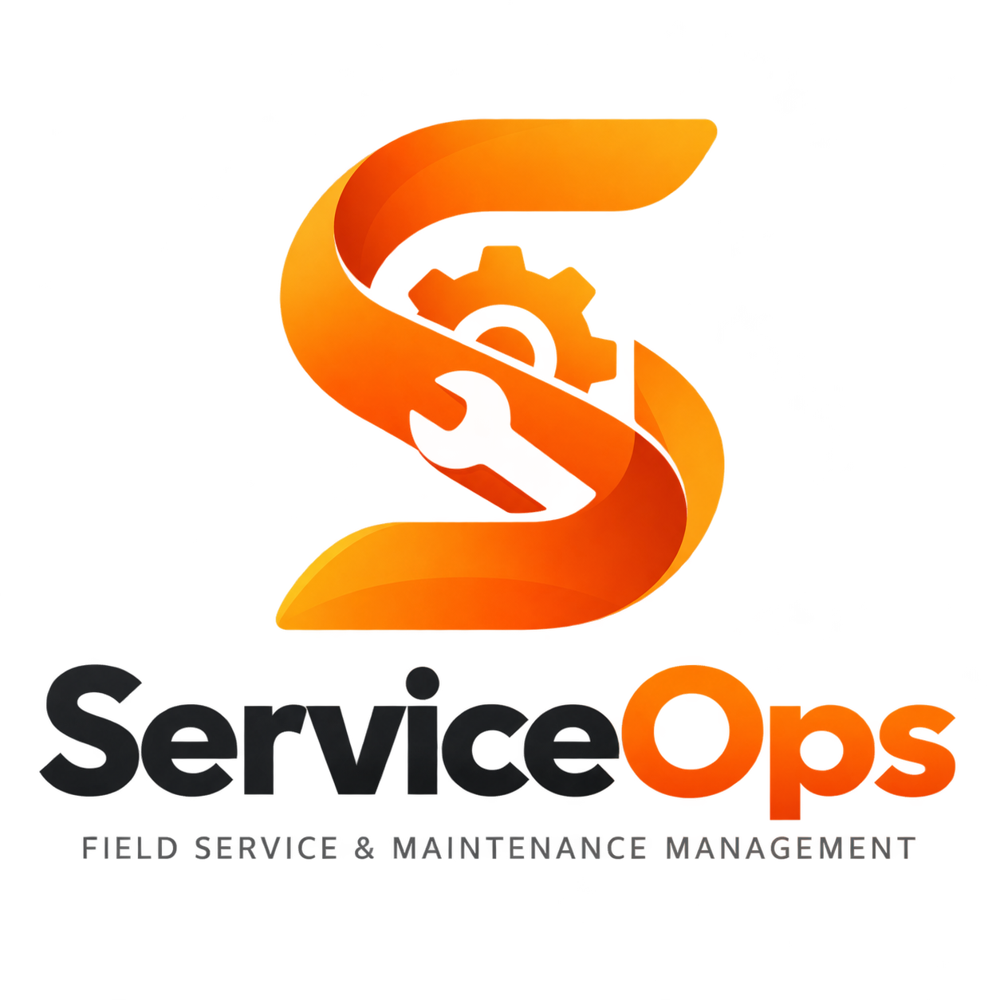
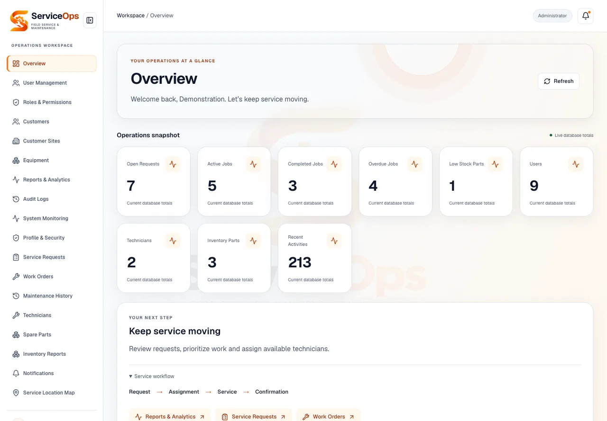
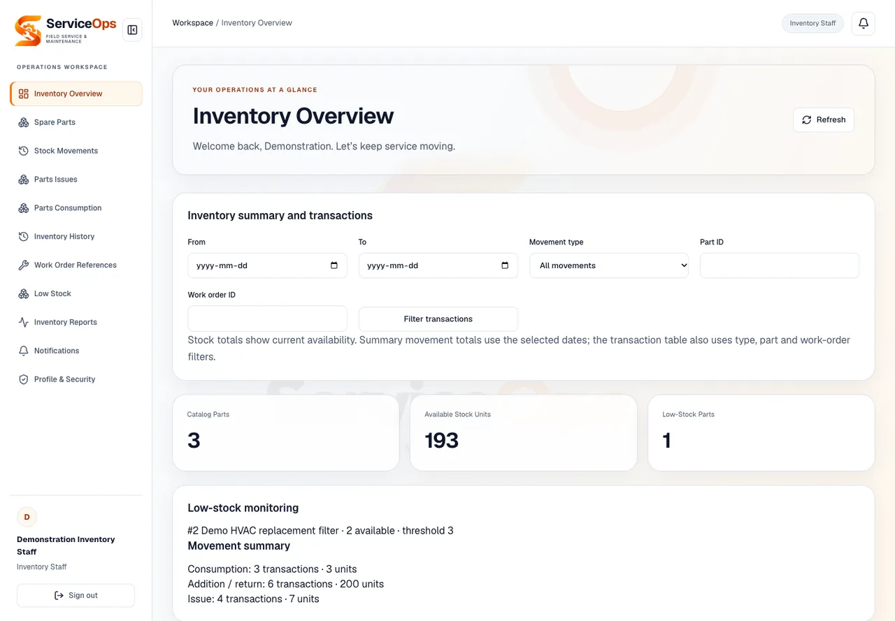
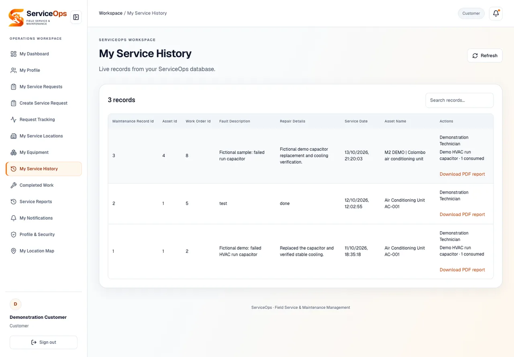

  

# ServiceOps — Higher Diploma Final Group Project

**ServiceOps** was completed as our **final group project** for the **Computing Project** module in the **4th semester** of the **Higher Diploma in Computing & Software Engineering**. Our group developed a role-based web application for service requests, field-service operations, inventory coordination and reporting. This repository documents the work our group completed together.

## Actual application screenshots

These screenshots come from the **ServiceOps application preview assets included in this repository**, not the earlier academic interface gallery. They depict the group's completed system using demonstration records.

| Operations dashboard | Inventory overview |
| --- | --- |
|  |  |

*Source: the checked-in frontend/public/previews application captures. These are existing UI screenshots, not newly verified live deployment captures.*

**Explore:** [Architecture diagram](docs/ARCHITECTURE.md) · [Collaborative project case study](docs/CASE_STUDY.md) · [Screenshot provenance](docs/SCREENSHOT_EVIDENCE.md) · [Dependency audit notes](docs/DEPENDENCY_NOTES.md)

## Project team

ServiceOps was developed collaboratively by **five students**. The responsibilities below come from our submitted project proposal.

| Team member | Assigned role(s) |
| --- | --- |
| [Kevin Menuja](https://github.com/kevin-menuja) | Project Manager / Solution Architect / Backend Integration Developer |
| [Mewanmee Sethnara](https://github.com/mewanmee10) | Business & System Analyst / Service Workflow Developer / Frontend Developer |
| [Gigiri Perera](https://github.com/gigiriperera123-eng) | Database Engineer / Backend API Developer |
| [Nethmi Tharaka](https://github.com/NethmiTharaka) | UI/UX Engineer / Frontend Developer |
| [Maheli Minethma](https://github.com/minethmamaheli) | QA Engineer / Backend Developer |

Read the [team responsibilities and project credit](docs/TEAM.md) for the responsibilities recorded in our proposal. This repository represents our **final group project**, not a solo submission.

## Features represented by the source

The backend includes authentication, roles and permissions, administrative controls, service operations, technician workflows, inventory and parts handling, locations, reporting, analytics, file attachments and customer interaction. Project roles include **Administrator, Service Manager, Technician, Inventory Manager and Customer**.

## Architecture

| Component | Technology | Directory |
| --- | --- | --- |
| Web client | Next.js 16, React 19, TypeScript | frontend |
| Backend API | ASP.NET Core, .NET 10, C# | backend/ServiceOps.Api |
| Persistence | PostgreSQL with EF Core/Npgsql | backend |
| Security | JWT and server-side permission policies | backend |

## Run locally

**Requirements:** Node.js and npm compatible with the frontend lockfile, .NET 10 SDK, and **an isolated PostgreSQL database**.

1. Create an empty disposable PostgreSQL database. Supply a private connection string through ConnectionStrings__DefaultConnection or DATABASE_URL according to the backend's configuration.
2. Provide a strong JWT signing key through the private Jwt__Key environment setting. Do not commit production credentials.
3. Restore and start the backend.
4. Copy the frontend example environment to a local ignored file; set BACKEND_API_URL to your backend's local address.
5. Install frontend dependencies and start the development server.

~~~bash
dotnet restore backend/ServiceOps.Api/ServiceOps.Api.csproj
dotnet run --project backend/ServiceOps.Api
cd frontend
cp .env.example .env.local
npm ci
npm run dev
~~~

Review backend database initialization and migrations before connecting to any data; never run seeders on real customer systems. Ensure frontend backend URL/CORS settings match.

## Project verification

~~~bash
dotnet build backend/ServiceOps.Api/ServiceOps.Api.csproj
cd frontend && npm run lint && npm run build
~~~

This archive is a group academic application, not a commissioned production deployment. It contains demo seeders and assets that require appropriate reuse rights. Original student reports and identifiers were not copied to this repository.

## Attribution

Completed collaboratively as the **final group project** for the Higher Diploma in Computing & Software Engineering. The repository preserves our group application and acknowledges all five project members in [TEAM.md](docs/TEAM.md). The proposal-defined responsibilities are credited as group roles, not proof of exclusive ownership of individual code files.
