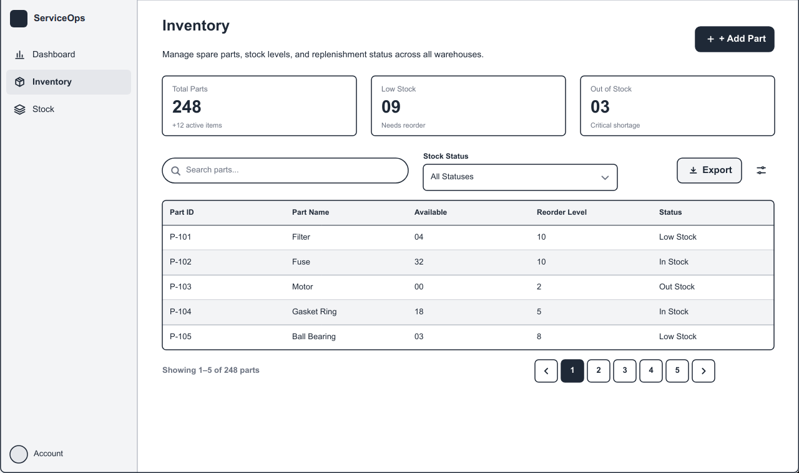

# ServiceOps — Academic Service Management Platform

An **academic higher-diploma group final project** exploring end-to-end service management and field operations through a web application. This repository is an archived coursework source snapshot, **not solely authored by one person**.

> **No AI features are claimed here.** The proposed ServiceOps AI Copilot, RAG assistant, LLM agents and production-scale extensions are separate, future engineering work.

## Academic interface gallery

| Service manager | Technician |
| --- | --- |
|  |  |

*Historical screenshots from the submitted group-project report, not a production deployment.*

**Explore:** [Architecture diagram](docs/ARCHITECTURE.md) · [Collaborative project case study](docs/CASE_STUDY.md) · [Screenshot provenance](docs/SCREENSHOT_EVIDENCE.md) · [Dependency audit notes](docs/DEPENDENCY_NOTES.md)

## Features represented by the source

The backend includes authentication, roles and permissions, administrative controls, service operations, technician workflows, inventory and parts handling, locations, reporting, analytics, file attachments and customer interaction. Project roles include **Administrator, Service Manager, Technician, Inventory Manager and Customer**.

## Architecture

| Component | Technology | Directory |
| --- | --- | --- |
| Web client | Next.js 16, React 19, TypeScript | frontend |
| Backend API | ASP.NET Core, .NET 10, C# | backend/ServiceOps.Api |
| Persistence | PostgreSQL with EF Core/Npgsql | backend |
| Security | JWT and server-side permission policies | backend |

## Run locally

**Requirements:** Node.js and npm compatible with the frontend lockfile, .NET 10 SDK, and **an isolated PostgreSQL database**.

1. Create an empty disposable PostgreSQL database. Supply a private connection string through ConnectionStrings__DefaultConnection or DATABASE_URL according to the backend's configuration.
2. Provide a strong JWT signing key through the private Jwt__Key environment setting. Do not commit production credentials.
3. Restore and start the backend.
4. Copy the frontend example environment to a local ignored file; set BACKEND_API_URL to your backend's local address.
5. Install frontend dependencies and start the development server.

~~~bash
dotnet restore backend/ServiceOps.Api/ServiceOps.Api.csproj
dotnet run --project backend/ServiceOps.Api
cd frontend
cp .env.example .env.local
npm ci
npm run dev
~~~

Review backend database initialization and migrations before connecting to any data; never run seeders on real customer systems. Ensure frontend backend URL/CORS settings match.

## Project verification

~~~bash
dotnet build backend/ServiceOps.Api/ServiceOps.Api.csproj
cd frontend && npm run lint && npm run build
~~~

This archive is a group academic application, not a commissioned production deployment. It contains demo seeders and assets that require appropriate reuse rights. Original student reports and identifiers were not copied to this repository.

## Attribution

Originally completed as a **collaborative higher-diploma group project**, not an individual solo project. This archive is curated for Kevin Menuja's personal engineering portfolio while preserving the project's group attribution. Other contributors' authorship must be respected, and individual contribution claims should be supported by project evidence.

**Status:** historical academic snapshot; the separately planned ServiceOps AI Copilot is not implemented in these files.
