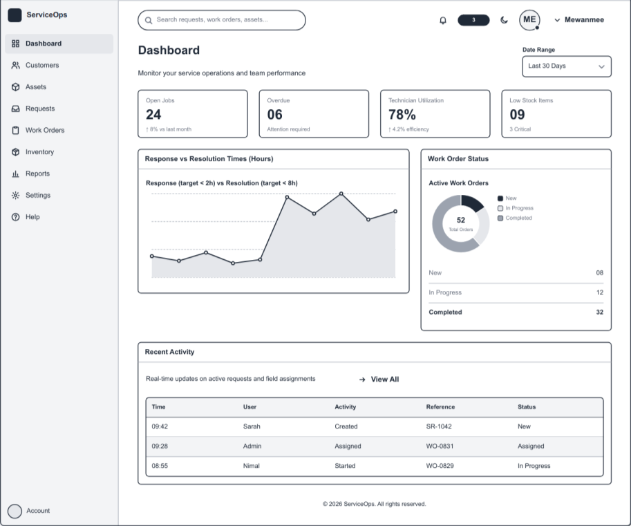
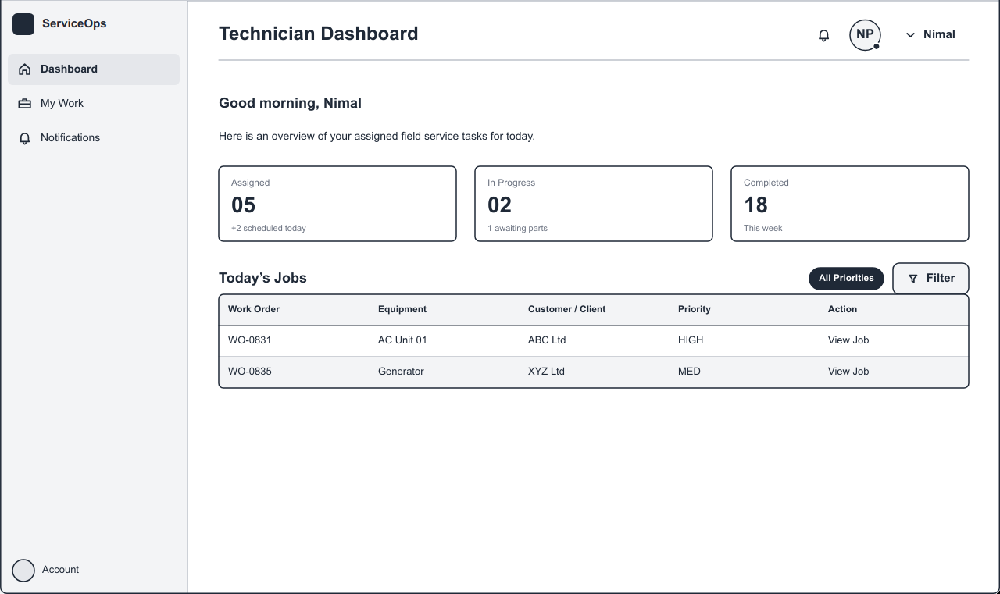
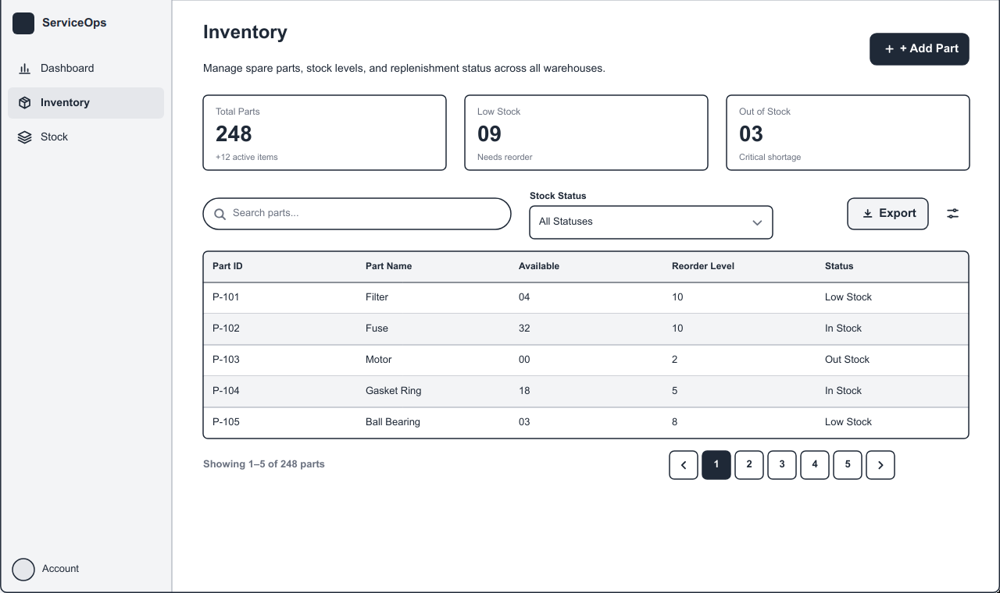

# Case study — ServiceOps field-service management

- **Project:** ServiceOps
- **Type:** Collaborative higher-diploma final project
- **Stack:** Next.js 16, React 19, TypeScript, ASP.NET Core 10, EF Core, PostgreSQL
**Status:** Archived academic source snapshot; not an AI Copilot or commissioned enterprise service

## Problem

Service operations require coordinated requests, work assignment, technician updates, parts/inventory oversight, customer communication and consistent reporting. The coursework application models these processes in one role-aware system instead of isolated spreadsheets or disconnected records.

## Implemented solution

The source contains a Next.js user interface and a separate ASP.NET Core API. Its backend models service requests, work orders, technicians, assets, spare parts, checklist items, attachments, notifications and audit history. Controllers expose authenticated service operations and administrative workflows. UI components provide focused workspaces for the documented five roles.

### Engineering choices

- **Role-oriented workflows:** The API defines permissions and roles for administrators, managers, technicians, inventory managers and customers.
- **Layered stack:** Next.js is responsible for web presentation and a backend proxy; ASP.NET Core implements business-facing endpoints.
- **Relational model:** PostgreSQL and EF Core migrations represent operational entities and their relationships.
- **Operational visibility:** The source includes analytics, reporting, work-order history and inventory-oriented views.
- **Security:** Server-side role checks and JWT flows are present, with further review needed for a real-world deployment.

The frontend and backend architecture are detailed in [ARCHITECTURE.md](ARCHITECTURE.md).

## Verified project evidence

In the prepared academic copy, the ASP.NET Core backend **built successfully with zero warnings and errors**. The Next.js frontend passed ESLint, TypeScript checking through the production build and Next.js compilation. GitHub Actions passed both build jobs.

The curated frontend moved to Next.js 16.4.6 and Zod 4.6.7; production dependency audit returned zero findings. Four moderate advisories remain in development-only generator tooling and are documented in [DEPENDENCY_NOTES.md](DEPENDENCY_NOTES.md).

These checks confirm a reproducible build. They are **not evidence of end-to-end functional acceptance or production operations**.

## Historical user-interface evidence

| Service-manager dashboard | Technician dashboard |
| --- | --- |
|  |  |

The images were embedded in the group's submitted academic report and are **historical screenshots**. Exact report page references appear in [SCREENSHOT_EVIDENCE.md](SCREENSHOT_EVIDENCE.md).

## Individual contribution and attribution

**This was a group project.** The repository and provided source alone do not establish which features Kevin Menuja personally implemented. Accordingly, this case study does not attribute specific components exclusively to him. A verified individual-contribution section can be added later using commit history, assigned tasks or group-report evidence confirmed by the original contributors.

## Constraints and honest scope

- The archive is not necessarily the most recent maintained ServiceOps codebase.
- No deployed production architecture, recovery rehearsal or formal customer acceptance is demonstrated here.
- Existing code contains **no AI Copilot**, LLM, RAG assistant or autonomous agent functionality.
- Media assets and group work may carry separate reuse and contribution rights that must be respected.
- A further engineering phase should add integration tests, monitoring, deployment hardening, synthetic-data demos and precise ownership records.

This case study demonstrates collaborative full-stack application architecture and operational-domain modeling without overstating production readiness or individual authorship.
