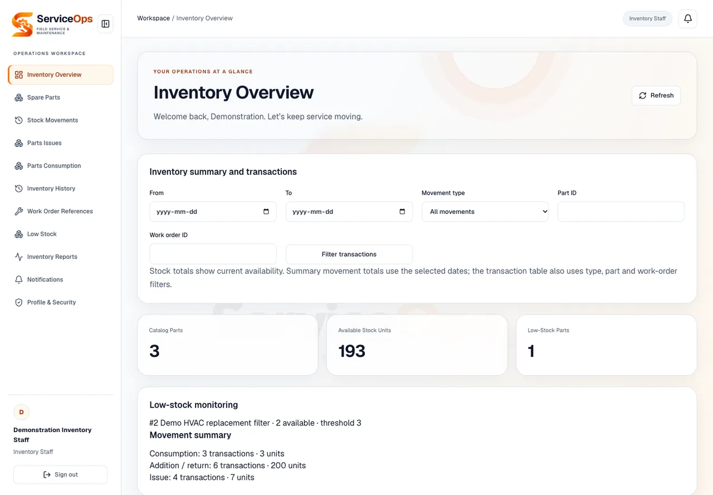
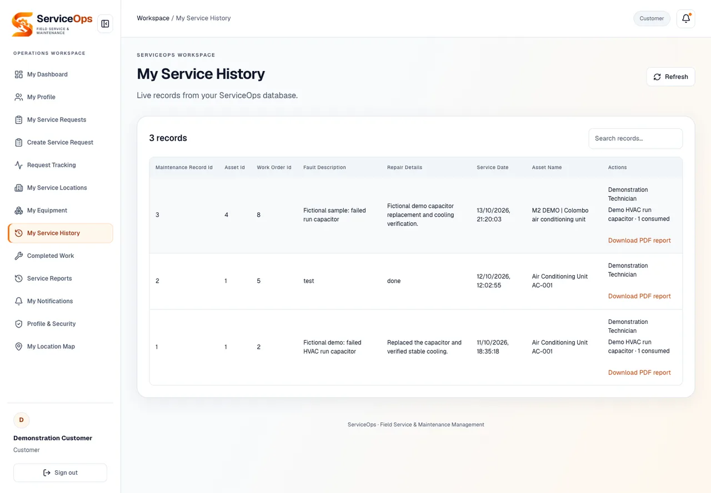

# Case study — ServiceOps final group project

- **Project:** ServiceOps
- **Qualification:** Higher Diploma in Computing & Software Engineering
- **Module:** Computing Project
- **Semester:** 4th
- **Type:** Final group project, completed collaboratively
- **Stack:** Next.js 16, React 19, TypeScript, ASP.NET Core 10, EF Core, PostgreSQL
- **Status:** Completed academic group application; archived source snapshot, not a commissioned production service

## Problem

Service operations require coordinated requests, work assignment, technician updates, parts/inventory oversight, customer communication and consistent reporting. The coursework application models these processes in one role-aware system instead of isolated spreadsheets or disconnected records.

## Implemented solution

The source contains a Next.js user interface and a separate ASP.NET Core API. Its backend models service requests, work orders, technicians, assets, spare parts, checklist items, attachments, notifications and audit history. Controllers expose authenticated service operations and administrative workflows. UI components provide focused workspaces for the documented five roles.

### Engineering choices

- **Role-oriented workflows:** The API defines permissions and roles for administrators, managers, technicians, inventory managers and customers.
- **Layered stack:** Next.js is responsible for web presentation and a backend proxy; ASP.NET Core implements business-facing endpoints.
- **Relational model:** PostgreSQL and EF Core migrations represent operational entities and their relationships.
- **Operational visibility:** The source includes analytics, reporting, work-order history and inventory-oriented views.
- **Security:** Server-side role checks and JWT flows are present, with further review needed for a real-world deployment.

The frontend and backend architecture are detailed in [ARCHITECTURE.md](ARCHITECTURE.md).

## Verified project evidence

In the prepared academic copy, the ASP.NET Core backend **built successfully with zero warnings and errors**. The Next.js frontend passed ESLint, TypeScript checking through the production build and Next.js compilation. GitHub Actions passed both build jobs.

The curated frontend moved to Next.js 16.4.6 and Zod 4.6.7; production dependency audit returned zero findings. Four moderate advisories remain in development-only generator tooling and are documented in [DEPENDENCY_NOTES.md](DEPENDENCY_NOTES.md).

These checks confirm a reproducible build. They are **not evidence of end-to-end functional acceptance or production operations**.

## Completed application screenshots

| Operations dashboard | Inventory overview |
| --- | --- |
|  |  |

These are the existing ServiceOps application preview captures checked into the group's frontend source. They are not claims of a newly tested live deployment. Earlier images from the academic report remain archived for historical evidence; see [SCREENSHOT_EVIDENCE.md](SCREENSHOT_EVIDENCE.md).

## Group contribution and attribution

**ServiceOps was our final group project.** The application, documentation and interface evidence represent collaborative diploma coursework. The five group members and their proposal-defined roles are credited in [TEAM.md](TEAM.md); no particular component is attributed exclusively to one member.

## Constraints and honest scope

- The archive is not necessarily the most recent maintained ServiceOps codebase.
- No deployed production architecture, recovery rehearsal or formal customer acceptance is demonstrated here.
- This documentation covers only the completed academic group application, not a commissioned commercial system.
- Media assets and group work may carry separate reuse and contribution rights that must be respected.

This case study describes the application architecture and operational-domain modeling completed collaboratively by the diploma project group.
